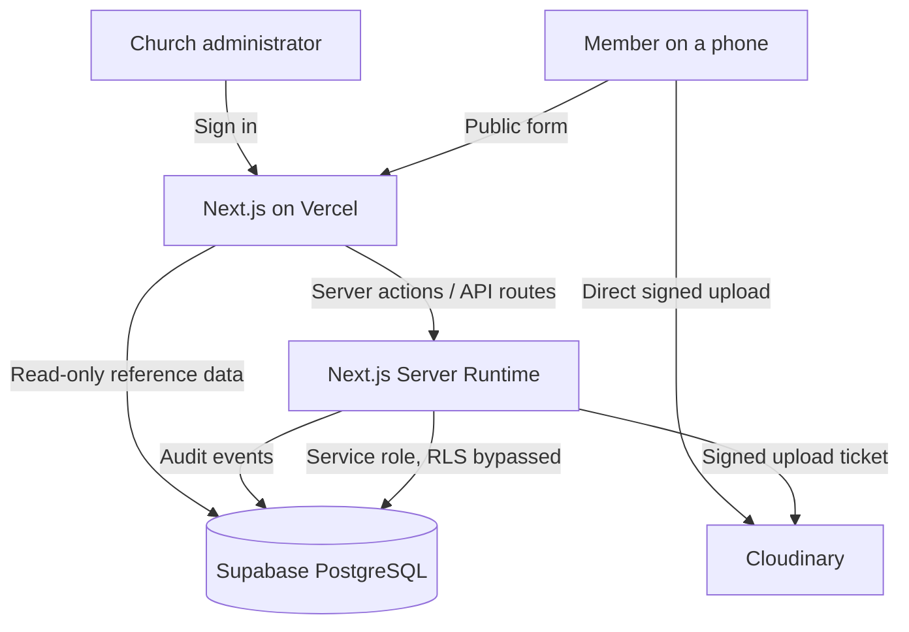
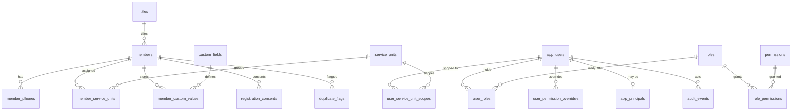

# Living Faith Church International — Laderin-Hilltop
## Membership Bio-Data Management Application

A production-quality, mobile-first membership bio-data capture and management
system for **Living Faith Church International (Winners Chapel), Laderin-Hilltop,
Ogun State, Nigeria**.

The public registration form lets any member register their bio-data and a
passport photograph without an account. A separate, permission-controlled
administrative dashboard lets church staff manage the register, review
possible duplicates, configure the form, produce reports and print membership
cards.

---

## Table of contents

1. [Technology stack](#1-technology-stack)
2. [Architecture at a glance](#2-architecture-at-a-glance)
3. [Required accounts](#3-required-accounts)
4. [Local prerequisites](#4-local-prerequisites)
5. [Repository setup](#5-repository-setup)
6. [Environment configuration](#6-environment-configuration)
7. [Supabase project creation](#7-supabase-project-creation)
8. [Applying the database migrations](#8-applying-the-database-migrations)
9. [Row Level Security and policies](#9-row-level-security-and-policies)
10. [Supabase Auth configuration](#10-supabase-auth-configuration)
11. [Cloudinary configuration](#11-cloudinary-configuration)
12. [Secure superadmin bootstrap](#12-secure-superadmin-bootstrap)
13. [Running locally](#13-running-locally)
14. [Running the tests](#14-running-the-tests)
15. [GitHub integration](#15-github-integration)
16. [Vercel deployment](#16-vercel-deployment)
17. [Production environment variables](#17-production-environment-variables)
18. [Authentication redirect configuration](#18-authentication-redirect-configuration)
19. [Production smoke test](#19-production-smoke-test)
20. [Backup and export procedures](#20-backup-and-export-procedures)
21. [Photograph cleanup and retention](#21-photograph-cleanup-and-retention)
22. [Recovery procedures](#22-recovery-procedures)
23. [Troubleshooting](#23-troubleshooting)
24. [Known free-tier limitations](#24-known-free-tier-limitations)
25. [Upgrade path](#25-upgrade-path)
26. [Implemented features](#26-implemented-features)
27. [Tests performed](#27-tests-performed)
28. [Known limitations and manual configuration](#28-known-limitations-and-manual-configuration)

---

## 1. Technology stack

| Concern | Choice | Notes |
| --- | --- | --- |
| Framework | Next.js 16 (App Router) with TypeScript | Server Components by default |
| Hosting | Vercel Hobby | Free tier |
| Database | Supabase PostgreSQL Free | |
| Authentication | Supabase Auth | |
| Database access | Server-side Supabase clients + SQL migrations | Service role used server-side only |
| Styling | Tailwind CSS v4 | |
| UI components | shadcn/ui patterns on Radix UI | Accessible primitives |
| Forms | React Hook Form + Zod | Shared client/server schemas |
| Icons | Lucide React | |
| Image storage | Cloudinary Free | Signed, direct-to-provider uploads |
| CSV | Native implementation with injection sanitisation | |
| Excel | ExcelJS | |
| PDF | PDFKit | |
| Unit testing | Vitest | |
| End-to-end testing | Playwright | |
| Version control | Git | |

---

## 2. Architecture at a glance



### Key architectural decisions

| Decision | Reason |
| --- | --- |
| All member data access goes through server-side code using the service-role key | RLS policies alone cannot express the church's role and scope model; authorization is enforced in the application, with RLS as defence in depth |
| The public form writes through a single transactional Postgres function (`create_member_registration`) | A member row and its related rows either all exist or none do — no partial registrations |
| The superadmin lives in a separate `app_principals` table | It is not a role that role-management code can read, write or assign, so it cannot be revoked or downgraded through the ordinary UI |
| Photographs upload directly from the browser to Cloudinary | The API secret never reaches the browser; the server issues a short-lived signed ticket that pins the allowed formats and maximum size |
| Service units, titles and custom fields are database-driven | The church can change the form without a redeployment |
| Member records are soft-deleted | Recoverable in line with the retention policy |

### Database relationships



Full schema documentation is in [`docs/DATABASE.md`](docs/DATABASE.md).

---

## 3. Required accounts

| Service | Plan | Purpose |
| --- | --- | --- |
| [Supabase](https://supabase.com) | Free | PostgreSQL database, authentication, Row Level Security |
| [Cloudinary](https://cloudinary.com) | Free | Passport photograph storage and delivery |
| [Vercel](https://vercel.com) | Hobby | Application hosting |
| [GitHub](https://github.com) | Free | Source control and deployment integration |

All four have a free tier sufficient for a church membership register. No
paid service is required at any point.

---

## 4. Local prerequisites

| Tool | Minimum version | Check with |
| --- | --- | --- |
| Node.js | 20.9 or later (22 LTS recommended) | `node -v` |
| npm | 10 or later | `npm -v` |
| Git | 2.30 or later | `git --version` |

Optional but recommended:

- [psql](https://www.postgresql.org/docs/current/app-psql.html) — to apply
  the migrations from the command line instead of the Supabase SQL editor.

---

## 5. Repository setup

```bash
# Clone the repository
git clone <your-repository-url> lfc-laderin
cd lfc-laderin

# Install dependencies
npm install
```

This installs the exact versions pinned in `package-lock.json`. Do not use
`npm install --force` or `--legacy-peer-deps`; every dependency resolves
cleanly.

---

## 6. Environment configuration

```bash
# Create your local environment file
cp .env.example .env.local
```

Then edit `.env.local` and fill in the values. `.env.local` is already listed
in `.gitignore` and must never be committed.

| Variable | Where it comes from | Exposed to the browser? |
| --- | --- | --- |
| `NEXT_PUBLIC_SUPABASE_URL` | Supabase → Project Settings → API | Yes (safe) |
| `NEXT_PUBLIC_SUPABASE_ANON_KEY` | Supabase → Project Settings → API (publishable/anon key) | Yes (safe) |
| `SUPABASE_SERVICE_ROLE_KEY` | Supabase → Project Settings → API (secret/service role key) | **Never** |
| `NEXT_PUBLIC_CLOUDINARY_CLOUD_NAME` | Cloudinary console | Yes (safe) |
| `CLOUDINARY_API_KEY` | Cloudinary console | **Never** |
| `CLOUDINARY_API_SECRET` | Cloudinary console | **Never** |
| `APP_URL` / `NEXT_PUBLIC_APP_URL` | Your deployed URL | Yes |
| `BOOTSTRAP_ADMIN_*` | You choose | **Never** (script only) |
| `MAX_UPLOAD_BYTES` | Optional, defaults to 5 MB | No |
| `PUBLIC_RATE_LIMIT_PER_HOUR` | Optional, defaults to 10 | No |

**The application fails safely.** If a mandatory server-side secret is missing,
the relevant server operation throws a clear error rather than silently
degrading. Missing secrets are detected at the point of use, not at build
time, so a missing `SUPABASE_SERVICE_ROLE_KEY` never reaches the browser
bundle.

---

## 7. Supabase project creation

1. Sign in at [supabase.com](https://supabase.com) and create a new project.
2. Choose a region close to Nigeria (e.g. **Africa (Cape Town)** or
   **Europe (Frankfurt)**) to reduce latency for church staff.
3. Set a strong database password and store it in your password manager — you
   will need it for backups.
4. Wait for the project to finish provisioning.
5. From **Project Settings → API**, copy:
   - Project URL → `NEXT_PUBLIC_SUPABASE_URL`
   - Publishable key / anon key → `NEXT_PUBLIC_SUPABASE_ANON_KEY`
   - Service role key / secret key → `SUPABASE_SERVICE_ROLE_KEY`
6. From **Project Settings → Database**, note the connection string for
   backups (see [section 20](#20-backup-and-export-procedures)).

> **Warning:** the service-role key bypasses Row Level Security. Treat it as
> a production password. If it is ever committed to git or exposed in a
> public channel, rotate it immediately in the Supabase dashboard.

---

## 8. Applying the database migrations

The migrations are plain SQL files in the `migrations/` folder and are safe to
re-run.

```bash
# List them in the order they must be applied
npm run migrations:list
```

| File | Purpose |
| --- | --- |
| `001_init_schema.sql` | Tables, indexes, constraints, triggers, the member-reference sequence |
| `002_rls_and_grants.sql` | Row Level Security, grants, the `user_has_permission` helper |
| `003_seed_reference_data.sql` | Permission catalogue, built-in roles, titles, service units, default settings |
| `004_bootstrap_helpers.sql` | The `grant_superadmin_principal` function and the ordinary-users directory view |
| `005_registration_rpc.sql` | The transactional `create_member_registration` function |

### Applying with the Supabase SQL editor (recommended)

1. Open **SQL Editor** in the Supabase dashboard.
2. Open a new query.
3. Paste the entire contents of `001_init_schema.sql` and click **Run**.
4. Repeat for `002` through `005`, in order.

### Applying with psql

```bash
# Local development only. For production, prefer the SQL editor or a
# purpose-built migration tool — psql against production is destructive
# if the wrong file is run.
psql "<your-database-connection-string>" -v ON_ERROR_STOP=1 -f migrations/001_init_schema.sql
psql "<your-database-connection-string>" -v ON_ERROR_STOP=1 -f migrations/002_rls_and_grants.sql
psql "<your-database-connection-string>" -v ON_ERROR_STOP=1 -f migrations/003_seed_reference_data.sql
psql "<your-database-connection-string>" -v ON_ERROR_STOP=1 -f migrations/004_bootstrap_helpers.sql
psql "<your-database-connection-string>" -v ON_ERROR_STOP=1 -f migrations/005_registration_rpc.sql
```

> **Warning:** never run `DROP`, `TRUNCATE` or `DELETE` against the
> production database. The migration files contain no destructive statements
> for existing data, and re-running them is safe.

---

## 9. Row Level Security and policies

RLS is enabled on **every** table by `002_rls_and_grants.sql`.

The policy model is:

- `anon` and `authenticated` are **revoked from all tables** by default.
- The only tables readable by a browser client are `service_units` and
  `titles` — reference data with no personal information — and only for
  `SELECT`.
- `members` grants `INSERT` to `authenticated` with an explicit **column
  list** that omits `reference_no`, `status`, `photo_*`, `created_by`,
  `updated_by` and the deletion columns. A public user therefore cannot set
  a privileged field, even by writing directly to the database.
- `user_has_permission(user_id, permission)` is a `SECURITY DEFINER`
  function restricted to the `service_role`. It implements the effective
  permission calculation: a `deny` override always wins over role grants.

All member, user, role, audit and settings access happens through the
server-side application code after it has performed its own authorization
check. RLS is the second line of defence, not the first.

---

## 10. Supabase Auth configuration

1. In the Supabase dashboard go to **Authentication → Providers → Email**.
2. Enable the **Email** provider.
3. **Turn off** "Confirm email" for new sign-ups, or leave it on and confirm
   administrator accounts by hand. The public registration form does not use
   Supabase Auth, so this setting only affects administrators.
4. Under **Authentication → URL Configuration**:
   - **Site URL**: set to your production URL, e.g. `https://lfc-laderin.vercel.app`
   - **Redirect URLs**: add both
     - `https://lfc-laderin.vercel.app/account/reset-password`
     - `http://localhost:3000/account/reset-password`
5. Under **Authentication → Session**, leave the defaults. Sessions are
   stored in cookies, which keeps them out of `localStorage`.

> There is deliberately **no public sign-up**. The dashboard creates
> administrator accounts itself.

---

## 11. Cloudinary configuration

1. Sign in at [cloudinary.com](https://cloudinary.com) and create a free
   account.
2. From the dashboard copy:
   - **Cloud name** → `NEXT_PUBLIC_CLOUDINARY_CLOUD_NAME`
   - **API key** → `CLOUDINARY_API_KEY`
   - **API secret** → `CLOUDINARY_API_SECRET`
3. Optionally create a dedicated folder, e.g. `lfc-laderin/members`, and set
   `CLOUDINARY_UPLOAD_FOLDER` accordingly. The application uses this folder
   for all member photographs.
4. Under **Settings → Security**, consider restricting the account to
   uploads only from your production domain.

### How uploads are secured

- The browser asks the server for an upload ticket
  (`requestUploadSignature` server action).
- The server rate-limits the request, then signs the timestamp, folder,
  public ID, **allowed formats**, **maximum file size** and transformation
  with the API secret.
- The browser uploads the file straight to Cloudinary using only that
  signature. The secret never leaves the server.
- The asset public ID is unpredictable (`lfc-<timestamp>-<hash>-<random>`),
  so photographs cannot be enumerated.
- The client validates the MIME type and size; the server validates the
  actual file signature (JPEG/PNG/WebP magic bytes) before accepting it.
  A renamed PDF or executable is rejected.
- The Cloudinary public ID and metadata are stored in PostgreSQL — never
  just a client-supplied URL.

---

## 12. Secure superadmin bootstrap

The superadmin is a **hidden system-level principal**, not an ordinary role.
It is stored in a separate `app_principals` table that the role and user
management code never reads or writes, so it cannot be revoked, downgraded or
reassigned through the application.

### Creating the first administrator

```bash
# Windows PowerShell
$env:BOOTSTRAP_ADMIN_EMAIL = "superadmin@lfcladerin.org"
$env:BOOTSTRAP_ADMIN_PASSWORD = "A-Strong-Temporary-Password-2026"
$env:BOOTSTRAP_ADMIN_NAME = "Superadmin"
$env:BOOTSTRAP_ADMIN_ROLES = "Resident Pastor"
npm run bootstrap:admin
```

```bash
# macOS / Linux
BOOTSTRAP_ADMIN_EMAIL="superadmin@lfcladerin.org" \
BOOTSTRAP_ADMIN_PASSWORD="A-Strong-Temporary-Password-2026" \
BOOTSTRAP_ADMIN_NAME="Superadmin" \
BOOTSTRAP_ADMIN_ROLES="Resident Pastor" \
npm run bootstrap:admin
```

The script reads `NEXT_PUBLIC_SUPABASE_URL` and `SUPABASE_SERVICE_ROLE_KEY`
from the environment or from `.env.local`.

**Properties of the script:**

- **Idempotent.** Running it again with the same email re-grants the
  principal and resets the temporary password. It never creates a duplicate
  privileged account.
- **No secrets in source.** Credentials come from environment variables
  only.
- **No password is printed.** The script confirms that a temporary password
  was set; it never echoes it.
- **The password must be changed.** The account is flagged
  `must_change_password`, and the dashboard refuses to show any protected
  page until the temporary password is replaced.
- **The password strength is enforced**: at least 12 characters with at
  least one letter and one number.

### Superadmin recovery

If the superadmin loses access:

1. Obtain a new service-role key from the Supabase dashboard (rotate it if
   the old one may be compromised).
2. Re-run `npm run bootstrap:admin` with the **same email address**. The
   script finds the existing Auth identity, resets its password to the
   temporary value and re-grants the principal.

This is the only supported recovery path, and it requires database-level
credentials that only the church's technical owner holds.

---

## 13. Running locally

```bash
# Development server with hot reload
npm run dev
```

Open [http://localhost:3000](http://localhost:3000).

| Route | Purpose |
| --- | --- |
| `/` | Public landing page |
| `/register` | Public membership registration form |
| `/privacy-policy` | Full privacy policy |
| `/login` | Administrator sign in |
| `/forgot-password` | Password recovery request |
| `/dashboard` | Administrative dashboard |

```bash
# Production build and serve (local)
npm run build
npm run start
```

> **Camera capture requires a secure context.** The browser only exposes
> `getUserMedia` and the `capture` attribute over HTTPS. On `http://localhost`
> most browsers still allow the camera, but on a LAN IP they will not. To
> test camera capture on a phone, use a tunnel such as `ngrok http 3000`
> or deploy to Vercel.

---

## 14. Running the tests

```bash
# Unit tests (Vitest) — validation, phone normalisation, RBAC catalogue,
# export sanitisation, image validation, custom-field rules
npm run test

# With a coverage report
npm run test:coverage

# End-to-end tests (Playwright)
npm run test:e2e:install   # once, downloads the browser
npm run test:e2e

# Type check and lint
npm run typecheck
npm run lint

# Everything
npm run verify
```

The Playwright suite covers the public journey by default. The authenticated
dashboard tests are skipped unless credentials are provided:

```bash
E2E_BASE_URL="http://localhost:3000" \
E2E_ADMIN_EMAIL="your@email.com" \
E2E_ADMIN_PASSWORD="your-password" \
npm run test:e2e
```

---

## 15. GitHub integration

1. Create a repository on GitHub.
2. Push the code:

```bash
git remote add origin <your-repository-url>
git add .
git commit -m "Initial release: LFC Laderin membership application"
git branch -M main
git push -u origin main
```

3. In **Settings → Secrets and variables → Actions**, add the deployment
   secrets if you want automated deploys:
   - `SUPABASE_URL`
   - `SUPABASE_ANON_KEY`
   - `SUPABASE_SERVICE_ROLE_KEY`
   - `CLOUDINARY_CLOUD_NAME`
   - `CLOUDINARY_API_KEY`
   - `CLOUDINARY_API_SECRET`

---

## 16. Vercel deployment

### Method A — Git integration (recommended)

1. Sign in at [vercel.com](https://vercel.com) and click **Add New →
   Project**.
2. Import your GitHub repository. Vercel detects Next.js automatically.
3. Leave the build settings as the defaults:
   - **Build command:** `npm run build`
   - **Output directory:** `.next`
   - **Install command:** `npm install`
4. Click **Deploy**.

### Method B — Vercel CLI

```bash
npm i -g vercel
vercel            # first run: link to a project
vercel --prod     # production deployment
```

### After the first deployment

1. Copy the production URL, e.g. `https://lfc-laderin.vercel.app`.
2. Set `APP_URL` and `NEXT_PUBLIC_APP_URL` to that URL in the Vercel
   environment variables (see [section 17](#17-production-environment-variables)).
3. Redeploy so the new variables take effect.
4. Add the redirect URL to Supabase Auth (see
   [section 18](#18-authentication-redirect-configuration)).

---

## 17. Production environment variables

In the Vercel dashboard: **Project → Settings → Environment Variables**.

| Name | Value | Scope |
| --- | --- | --- |
| `NEXT_PUBLIC_SUPABASE_URL` | Your Supabase project URL | Production, Preview, Development |
| `NEXT_PUBLIC_SUPABASE_ANON_KEY` | Publishable/anon key | Production, Preview, Development |
| `SUPABASE_SERVICE_ROLE_KEY` | Service role key | **Production only** |
| `NEXT_PUBLIC_CLOUDINARY_CLOUD_NAME` | Cloudinary cloud name | Production, Preview, Development |
| `CLOUDINARY_API_KEY` | Cloudinary API key | Production |
| `CLOUDINARY_API_SECRET` | Cloudinary API secret | **Production only** |
| `CLOUDINARY_UPLOAD_FOLDER` | `lfc-laderin/members` | Production |
| `APP_URL` | `https://your-domain.vercel.app` | Production |
| `NEXT_PUBLIC_APP_URL` | `https://your-domain.vercel.app` | Production |
| `MAX_UPLOAD_BYTES` | `5242880` | Production (optional) |
| `PUBLIC_RATE_LIMIT_PER_HOUR` | `10` | Production (optional) |
| `UPLOAD_RATE_LIMIT_PER_HOUR` | `20` | Production (optional) |

> Do **not** set `BOOTSTRAP_ADMIN_*` in Vercel. Those variables are read
> only by the local provisioning script.

> `NEXT_PUBLIC_*` variables are inlined into the browser bundle at build
> time. Only ever put browser-safe values in them. Changing one requires a
> rebuild, not just a restart.

---

## 18. Authentication redirect configuration

In the Supabase dashboard: **Authentication → URL Configuration**.

| Setting | Value |
| --- | --- |
| Site URL | `https://your-domain.vercel.app` |
| Redirect URLs | `https://your-domain.vercel.app/account/reset-password` |
| | `http://localhost:3000/account/reset-password` |
| | `https://your-domain.vercel.app/dashboard` (optional) |

If you add a custom domain, add its redirect URL too.

Password-reset emails are sent by Supabase. On the free plan the default
`Supabase <noreply@supabase.io>` sender has a strict rate limit. For a busy
church you may want to configure a custom SMTP provider — that is a paid
option and is **not required** for this release.

---

## 19. Production smoke test

Run through this checklist after every production deployment.

### Public journey (no account needed)

1. Open `https://your-domain.vercel.app/register`.
   - The church logo, name and "Laderin-Hilltop" are visible.
   - The form is usable on a phone with no sideways scrolling.
2. Submit the form with nothing filled in.
   - Inline error messages appear; nothing is saved.
3. Fill the form with a test member, including a photograph.
   - The photograph uploads and a preview appears.
   - The consent box is unchecked by default and must be ticked.
4. Submit.
   - A reference number such as `LFC-LH-2026-000001` is shown.
   - The success message confirms the registration.
5. Sign in as the superadmin and confirm the new member appears in the
   directory, with the photograph attached.

### Administrative journey

6. Sign in at `/login`.
   - The dashboard loads with statistics.
7. Open the member directory.
   - Search, filters, sorting and pagination work.
   - The card view renders.
8. Open the member profile and edit a field.
   - The change is saved and the audit log records it.
9. Export to CSV, Excel and PDF.
   - Each file downloads and opens correctly with the expected rows.
10. Print the member table and a member card.
    - The print preview shows the table or card without dashboard navigation.
11. Try a duplicate registration with the same phone number.
    - A duplicate alert appears in **Duplicate review**.
    - Resolving it is recorded in the audit log.
12. Sign out and confirm the dashboard is no longer reachable.

---

## 20. Backup and export procedures

The Supabase Free plan includes daily automated backups (7 days of retention
on the current plan), but you should still take your own copies.

### Database export (recommended weekly)

**From the dashboard:**

1. Supabase dashboard → **Project** → **Database** → **Backups**.
2. Download a backup.

**From the command line** (development machine or a trusted server):

```bash
pg_dump \
  --host=db.YOUR-PROJECT-REF.supabase.co \
  --port=5432 \
  --username=postgres.YOUR-PROJECT-REF \
  --dbname=postgres \
  --no-owner \
  --no-privileges \
  --format=custom \
  --file="lfc-laderin-backup-$(date +%F).dump"
```

> **Warning:** the dump contains every member's personal data, including
> photograph references and consent records. Store the backup encrypted, in
> a location restricted to the church's authorised data officers, and
> delete it when the retention period expires. Do not commit it to git.

### Photograph backup

Photographs live in Cloudinary, not in the database. To keep a copy:

1. Export the member register to CSV from the dashboard.
2. For each member with a photograph, use the Cloudinary **Assets** view to
   download the original, or use the Cloudinary Admin API to generate an
   archive.

### Restoring a backup

```bash
# WARNING: this OVERWRITES the current database. Test it on a copy first.
pg_restore --clean --if-exists --no-owner --no-privileges \
  --dbname="postgres" "lfc-laderin-backup-YYYY-MM-DD.dump"
```

> **Warning:** restoring a backup over a live production database destroys
> every record created since the backup was taken. Always take a fresh
> backup first, and practice the restore procedure on a scratch project.

---

## 21. Photograph cleanup and retention

### Retention policy

The default policy is configurable in **Application settings → Data retention
policy**:

| Setting | Default | Meaning |
| --- | --- | --- |
| Keep member records for | 7 years | How long an active member record is retained |
| Keep deleted records for | 24 months | How long a soft-deleted record stays recoverable |
| Delete photograph on permanent delete | On | Whether the Cloudinary asset is destroyed when a record is purged |

### What happens on delete

| Action | Database row | Photograph | Recoverable |
| --- | --- | --- | --- |
| Soft delete (the normal delete) | `status = 'deleted'`, timestamp and reason recorded | Kept | Yes — an administrator can restore it |
| Permanent delete | Row and related rows removed by cascade | Destroyed from Cloudinary | No |

Every delete and restore is written to the audit log with the actor, the
record reference and the reason.

### Manual clean-up

The soft-delete timestamp lets you find records past their retention period:

```sql
-- Preview what is past the retention window. Read-only — safe to run.
select reference_no, full_name, deleted_at
from public.members
where status = 'deleted'
  and deleted_at < now() - interval '24 months'
order by deleted_at;
```

Only after reviewing that list should you purge the records, using the
**Permanently delete** action in the member profile (which requires typing
`DELETE PERMANENTLY` to confirm). Each purge is audited.

### Orphaned Cloudinary assets

If a browser uploads a photograph but the registration then fails, the asset
is left in Cloudinary without a database row. Find them with:

1. The Cloudinary console → **Assets** → filter by the
   `lfc-laderin/members` folder and by upload date.
2. Compare the public IDs against `select photo_public_id from public.members`
   in the database.
3. Delete the assets that have no matching row.

A scheduled clean-up job can automate this, but it is not required for the
free tier and is not included in this release.

---

## 22. Recovery procedures

### The database is unavailable

- The public form shows a friendly message asking the member to try again
  later. No data is lost, because the submission is written in a single
  transaction.
- The dashboard shows an error rather than an empty register — it never
  silently displays "0 members" when the database is unreachable.
- **Action:** check the Supabase project status page, confirm the database
  is not paused for inactivity (see [section 24](#24-known-free-tier-limitations)),
  and restore from backup if necessary.

### Cloudinary is unavailable

- Members can still complete every field of the form; only the photograph
  upload fails, and the failure is shown clearly.
- A registration can be submitted without a photograph, and the photograph
  can be added later by an administrator.
- **Action:** check the Cloudinary status page. Existing photographs are
  unaffected because they are served from Cloudinary's CDN.

### The superadmin account is locked out

1. Rotate or obtain the Supabase service-role key.
2. Re-run `npm run bootstrap:admin` with the same email address
   (see [section 12](#12-secure-superadmin-bootstrap)).
3. Sign in and set a new password.

### An administrator account is compromised

1. Suspend the account in **User management**. Access is revoked on the
   next request and active sessions are terminated.
2. Issue a new temporary password for the user if they still need access.
3. Review **Audit logs** for anything unusual done by that account.
4. If the superadmin was compromised, rotate the Supabase service-role key
   and the Cloudinary API secret immediately.

### The application is showing stale data

The member directory is read from the database on every request, so it is
never stale by design. If you see stale data, the browser is showing a
cached page — force a hard refresh, or check that the deployment completed.

---

## 23. Troubleshooting

| Symptom | Likely cause | Fix |
| --- | --- | --- |
| "Missing required environment variable" on any page | `.env.local` is incomplete | Copy `.env.example` again and fill in every value |
| Public form loads but titles and units are missing | Migrations not applied, or `003` was skipped | Apply `migrations/003_seed_reference_data.sql` |
| Sign-in fails with "not enabled for the administration dashboard" | The Auth user has no `app_users` row | Run the bootstrap script, or create the account in **User management** |
| Sign-in succeeds but the dashboard redirects to the password screen | `must_change_password` is set | Set a new password — this is the intended behaviour for temporary passwords |
| Photograph upload fails with a signature error | `CLOUDINARY_API_SECRET` is wrong, or the server clock is off | Re-copy the secret; check your system time |
| Photograph upload fails with a format error | The file is not a real JPEG/PNG/WebP | The file signature is validated — convert the image properly |
| Photographs upload but do not appear | `NEXT_PUBLIC_CLOUDINARY_CLOUD_NAME` is wrong | Re-copy the cloud name and redeploy |
| CSV opens with garbled names | The reader ignored the UTF-8 BOM | Use Excel's "Data → From Text/CSV" and choose UTF-8 |
| The member directory is empty | The signed-in user has a service-unit scope that matches no records | Adjust the scope in **User management**, or check the member's unit assignment |
| Export returns "You do not have permission" | The role lacks the export permission | Add it in **Roles and permissions** |
| `npm run build` fails with "Route segment config 'dynamic' is not compatible with cacheComponents" | `cacheComponents` was enabled in `next.config.ts` | Keep `cacheComponents: false` — this application is fully dynamic |
| The build fails with "missing export" for a component | A Radix component is used but not imported | Add it to the import list from `@/components/ui/dropdown-menu` |
| Vercel build fails with "Module not found: server-only" | A server-only module was imported into a client component | Import the constants from `@/lib/auth/permission-keys` or the URL builder from `@/lib/cloudinary-url` instead |

---

## 24. Known free-tier limitations

These limits are set by the free tiers of the three external services. They
are real and will affect the church at scale. **No claim of guaranteed zero
cost or unlimited capacity is made.**

### Vercel Hobby

| Limit | Value | Effect |
| --- | --- | --- |
| Deployments | 100 per day | More than enough |
| Bandwidth | 100 GB per month | The photographs are served by Cloudinary, not Vercel, so the main cost is the application itself |
| Function execution | 100 GB-hours per month (Fluid compute) | Comfortable for a membership register |
| Max duration | 300 s (Fluid) | Exports of a few thousand rows are fine; very large exports should be paginated |
| Build time | 600 s (Hobby) | The current build takes roughly 3–6 minutes |
| No commercial use | — | Appropriate for a church |
| No preview comments / no analytics | — | Not required |

### Supabase Free

| Limit | Value | Effect |
| --- | --- | --- |
| Database size | 500 MB | Roughly 50,000+ members with text-only records; the database stores no image binaries |
| Storage | 1 GB | Not used — photographs live in Cloudinary |
| Bandwidth | 5 GB egress per month | The public form and the dashboard are light on traffic |
| **Project pause** | Paused after 7 days of no activity on the free plan | **Important:** a paused project does not accept connections. Visit the dashboard at least weekly, or upgrade |
| Email (auth) | 2 emails per hour | Only used for password resets, which are rare |
| Backups | 7 days | Take your own weekly dumps |
| Support | Community only | — |

### Cloudinary Free

| Limit | Value | Effect |
| --- | --- | --- |
| Storage | 25 GB | Roughly 25,000 passport photographs at 1 MB each |
| Transformations / delivery | 25 GB bandwidth per month | Each thumbnail is ~10–20 KB thanks to the applied transformations |
| Managed transformations | 500 credits per month | The applied transformations are "eager" (applied at upload), so they consume no transformation credits |
| Assets | 2,500 per month created | Fine for a church |
| Backups | Not available on the free plan | The church must accept this risk or maintain its own asset copy |

### Practical guidance

- Keep an eye on the Supabase project: **visit it weekly** so it is not
  paused for inactivity.
- Take a weekly database dump and store it off-site.
- The application uses eager transformations so that every delivery is a
  plain CDN fetch — this is the cheapest pattern for the Cloudinary free
  plan.
- If the church grows past these limits, the upgrade path is in
  [section 25](#25-upgrade-path).

---

## 25. Upgrade path

The architecture was designed so the church can grow without a rewrite.

### Phase 2 — the modules that are not yet built

The data model already supports them; only the screens and workflows are
missing:

| Module | Notes |
| --- | --- |
| Attendance register | A member-scoped table plus a dashboard view |
| Tithes and offerings | A ledger table with a `members` foreign key |
| Cell group administration | Reuse the `service_units` pattern with a new table |
| Event management | Events plus a many-to-many attendance table |
| Pastoral counselling notes | A separate, permission-restricted table |

### Structural approach

1. **Add a migration** for the new tables. Do not modify the existing
   migration files — they are already applied in production.
2. **Add a new module folder** under `src/app/dashboard/<module>/` and reuse
   the existing `Card`, `Table`, `Button` and form components.
3. **Add permissions** in a new migration that inserts into
   `public.permissions`, and add the matching constants to
   `src/lib/auth/permission-keys.ts`. The permission catalogue is designed
   to be extended.
4. **Add a role** through the **Roles and permissions** screen — no code
   change is needed for a new role.
5. **Add navigation** to `NAV_ITEMS` in
   `src/components/dashboard/dashboard-shell.tsx` with the matching
   permission. Navigation is filtered by permission, and the server enforces
   the same permission independently.

### Deliberate design choices that make this possible

- The `members` table carries no module-specific columns, so new modules
  never require a migration to the core table.
- Custom fields already allow the church to collect most new data points
  without a code change.
- Photos are stored as a Cloudinary public ID with the transformations
  applied at upload time, so a new print size does not require re-uploading.

---

## 26. Implemented features

### Public registration

- Single-page form, no account required, mobile-first
- Configurable titles, gender, age category, day/month-only date of birth
- Multiple service units with a "No Service Units Yet" option that clears
  the other selections
- Primary phone with Nigerian normalisation, WhatsApp number, up to five
  additional numbers
- Optional email, address, membership duration, suggestions
- Camera capture **and** file selection, with a preview, retake and remove
- Content-based file validation (JPEG/PNG/WebP magic bytes), configurable
  maximum size, direct-to-Cloudinary signed upload
- Privacy notice with a version, unchecked-by-default consent, and separate
  parent/guardian consent for children
- Active public custom fields, validated on both client and server
- Unique member reference number, idempotency protection, rate limiting
- Accessible success message with the reference number

### Administrative dashboard

- Server-enforced RBAC across 25 granular permissions
- Hidden superadmin principal, excluded from role and user listings
- Overview statistics: totals, age category, gender, service unit,
  duration, photograph coverage, pending duplicates, registration trend
- Member directory: table and card views, search, 8 filters, sorting,
  pagination, combined filters, clear-filters action
- Member profile with personal, contact, membership, photograph, custom
  field and metadata sections
- Create, edit, soft-delete, restore and permanently delete
- Duplicate detection on phone, email and name, with a side-by-side review
  interface and audited resolution
- Service-unit, title, custom-field, user, role and permission management
- Application settings: privacy notice, form behaviour, retention policy
- Audit log of every significant administrative action
- CSV, Excel and PDF exports that respect the active filters, the access
  scope and field visibility, with spreadsheet formula injection mitigated
- Printable member table and individual and bulk member cards
- Account profile and password management, with a forced password change

### Security and privacy

- Row Level Security on every table; the browser client is revoked from
  all personal data
- Column-level grants so a public user cannot set privileged fields
- Server-side authorization on every operation, re-checked on submission
- Service-unit record scoping applied consistently to lists, profiles,
  search, exports, prints and statistics
- The superadmin enforced by a dedicated system-level table, not a
  client-supplied role name
- Audit logging with minimised change summaries and no credentials
- Soft deletion with an explicit, audited permanent-delete path
- Rate limiting on public registration and upload signing

### Accessibility

- Large type and 44–48 px tap targets
- Visible labels above inputs, inline errors with `role="alert"`
- Strong focus indicators, full keyboard navigation
- Semantic HTML and ARIA only where needed
- Responsive from 320 px phones to desktop
- Reduced-motion support
- Accessible charts that expose their data as text

---

## 27. Tests performed

### Automated

| Suite | Command | Result |
| --- | --- | --- |
| Unit tests (Vitest) | `npm run test` | **94 passing** across 6 files |
| Type check | `npm run typecheck` | Clean |
| Lint | `npm run lint` | Clean |
| Production build | `npm run build` | Succeeds; 24 routes, 6 static, 18 dynamic |
| End-to-end (Playwright) | `npm run test:e2e` | Specs written; run against a live deployment to confirm |

**Unit test coverage includes:**

- Phone normalisation for every Nigerian format, international formats, and
  the `00` prefix — including the property that differently written forms of
  the same number produce the same matching key
- Registration validation: required fields, day/month-only date of birth,
  the leap-day edge case, 30 February and 31 April rejections, guardian
  consent for children, email and phone formats
- Spreadsheet formula injection: `=`, `+`, `-`, `@`, leading whitespace and
  embedded control characters
- CSV quoting and escaping, and Unicode name preservation
- Image content validation: real JPEG, PNG and WebP accepted; a renamed
  PDF, an executable and a script all rejected
- Custom-field definition and value validation, including the rejection of
  executable content in a field key
- The permission catalogue: every required permission present, no
  duplicates, correct naming format

### Manual verification performed

- The production build completes and every route is registered correctly
- Public pages are server-rendered; the dashboard is dynamic
- Server-only modules are correctly excluded from client bundles (verified
  by the build, which fails loudly if a client component imports one)

### To be verified against a live deployment

The following need a real Supabase and Cloudinary account, so they are
covered by the Playwright suite rather than the unit suite:

- A registration saved end to end, with the photograph attached
- A duplicate alert raised and resolved
- Each export format downloaded and opened
- The forced password change for a temporary password
- A suspended account losing access
- The superadmin excluded from the user list

---

## 28. Known limitations and remaining manual configuration

### Manual configuration required before going live

1. **Create the first superadmin** with `npm run bootstrap:admin`
   ([section 12](#12-secure-superadmin-bootstrap)).
2. **Set the church's real contact details** in **Application settings →
   Privacy notice** — the placeholders must be replaced before members see
   them.
3. **Review the privacy notice with a Nigerian data-protection professional.**
   The generated notice supports the church's obligations under the Nigeria
   Data Protection Act 2023; it is not a substitute for legal advice.
4. **Confirm the retention period** in **Application settings → Data
   retention policy** matches the church's own policy.
5. **Set the site URL and redirect URLs** in Supabase Auth
   ([section 18](#18-authentication-redirect-configuration)).
6. **Take the first database backup** and store it securely.
7. **Visit the Supabase project weekly** so the free plan does not pause it.

### Known limitations

- **No merge action for confirmed duplicates.** A confirmed duplicate is
  flagged and audited, and the merge itself is a deliberate manual step. A
  merge UI is a sensible next feature.
- **No bulk selection in the directory.** Exports and prints cover the
  current filter rather than an arbitrary selection. Bulk selection is a
  natural addition.
- **No automated photograph clean-up.** Orphaned assets are removed by hand
  (see [section 21](#21-photograph-cleanup-and-retention)).
- **No email delivery for new members.** Members receive a reference number
  on screen, not by email.
- **Password-reset email is rate-limited by Supabase's free tier** (two
  emails per hour). A custom SMTP provider is a paid addition.
- **The audit log is append-only through the application** but a database
  administrator with direct access could still alter it.
- **Photographs are delivered from Cloudinary's public CDN.** Access control
  relies on the administrative application, not on an unguessable URL, as
  required. A paid Cloudinary plan with signed delivery would strengthen
  this further.
- **Statistics are computed in the application**, not with a materialised
  view. This is comfortably fast for a church-sized register, but a very
  large register would benefit from a cached aggregate.
- **The Tithes, offerings, attendance, cell group, event and counselling
  modules are deliberately out of scope** for this release, as specified.

### Security follow-up

The `npm audit` report lists two advisories in build-time dependencies:
`braces` (via `eslint-config-next`) and `uuid` (via `exceljs`). Both are
development-time or write-path-only and are not reachable in the deployed
application's attack surface. Run `npm audit` regularly and update when
upstream fixes land.

---

## Licence and attribution

The official church logo (`public/brand/lfc-logo.png`) is the property of
Living Faith Church International / Winners Chapel International and is used
with permission for this internal application. All other branding in the
application is derived from that asset.

The privacy notice text in this application supports, but does not replace,
the church's obligations under the Nigeria Data Protection Act 2023.
