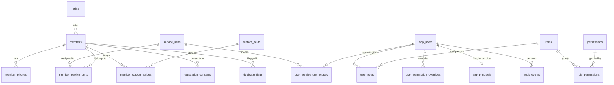

# Database schema

Living Faith Church International — Laderin-Hilltop
Membership Bio-Data Management System

All tables live in the `public` schema. Primary keys are UUIDs generated with
`gen_random_uuid()`. Timestamps are `timestamptz` in UTC.

---

## 1. Entity relationship diagram

---

## 2. Table reference

### `members`

The core register. One row per person.

| Column | Type | Notes |
| --- | --- | --- |
| `id` | uuid | Primary key |
| `reference_no` | text | **Unique.** `LFC-LH-<year>-<6 digits>`, from a sequence so concurrent submissions never collide |
| `full_name` | text | 2–200 characters, whitespace-normalised |
| `title_id` | uuid → `titles` | `ON DELETE SET NULL` — a deleted title does not delete a member |
| `gender` | text | `male` \| `female` (check constraint) |
| `age_category` | text | `child` \| `youth` \| `adult` (check constraint) |
| `birth_day` | integer | 1–31, **no year is ever stored** |
| `birth_month` | integer | 1–12 |
| `primary_phone` | text | Exactly as the member typed it, for display |
| `primary_phone_normalized` | text | `+2348012345678` — used for matching and duplicate detection |
| `whatsapp_same_as_primary` | boolean | |
| `whatsapp_phone` / `whatsapp_phone_normalized` | text | |
| `email` | text | As typed |
| `email_normalized` | text | Lower-cased — used for matching |
| `residential_address` | text | |
| `membership_duration` | text | `lt_1y` \| `y1_3` \| `y4_6` \| `y7_10` \| `gt_10y` |
| `suggestions` | text | Free text from the member |
| `photo_public_id` | text | Cloudinary public ID — **not** a URL, and never client-supplied |
| `photo_format`, `photo_width`, `photo_height`, `photo_bytes` | | Photo metadata |
| `photo_uploaded_at` | timestamptz | |
| `status` | text | `active` \| `deleted` — soft deletion |
| `deleted_at`, `deleted_by`, `deletion_reason` | | Recovery metadata |
| `registration_source` | text | `public_form` \| `admin` |
| `idempotency_key` | text | **Unique index.** A repeated public submission id can never create a second row |
| `created_by`, `updated_by` | uuid | The acting administrator, when there is one |
| `created_at`, `updated_at` | timestamptz | |

**Constraints.** A check constraint validates the day against the month,
allowing 29 February for a leap-day birth date. Another enforces the 2–200
character name length.

**Indexes.** Lower-cased name, normalised primary phone, normalised WhatsApp
phone, normalised email, status, `created_at DESC`, age category, gender,
membership duration, title, and a partial unique index on
`idempotency_key`.

> **Photographs are never stored in PostgreSQL.** The database holds only the
> Cloudinary public ID and its metadata.

### `member_phones`

| Column | Type | Notes |
| --- | --- | --- |
| `id` | uuid | Primary key |
| `member_id` | uuid → `members` | `ON DELETE CASCADE` |
| `phone` | text | As typed |
| `phone_normalized` | text | International form |
| `label` | text | `primary` \| `whatsapp` \| `other` |
| `is_primary` | boolean | |

### `member_service_units`

| Column | Type | Notes |
| --- | --- | --- |
| `id` | uuid | Primary key |
| `member_id` | uuid → `members` | `ON DELETE CASCADE` |
| `service_unit_id` | uuid → `service_units` | `ON DELETE RESTRICT` — a unit with members cannot be deleted |
| `assigned_at`, `assigned_by` | | |

Unique on `(member_id, service_unit_id)`.

### `service_units`

Configurable. `name`, `slug` (unique), `description`, `is_active`,
`sort_order`. A deactivated unit is hidden from the public form but remains
visible on historical records.

### `titles`

Configurable. `name`, `slug` (unique), `is_active`, `sort_order`. Titles are
not verified — members choose their own.

### `custom_fields`

The database-driven field system.

| Column | Notes |
| --- | --- |
| `field_key` | **Unique.** Lowercase identifier matching `^[a-z][a-z0-9_]*$` |
| `label` | Display label |
| `field_type` | `short_text`, `long_text`, `select`, `multi_select`, `checkbox`, `date`, `number`, `email`, `telephone`, `yes_no` |
| `help_text` | |
| `is_required` | |
| `default_value` | jsonb |
| `options` | jsonb array of `{ label, value }` — **plain strings only**, never code |
| `validation` | jsonb: `min_length`, `max_length`, `min`, `max`, `pattern` |
| `sort_order` | |
| `is_active` | Deactivation preserves existing values |
| `show_on_public_form`, `show_on_profile`, `show_on_card`, `show_in_table`, `show_in_export` | Visibility flags |
| `is_sensitive`, `required_permission` | An extra permission is needed to read the value |

### `member_custom_values`

| Column | Notes |
| --- | --- |
| `member_id`, `field_id` | Composite primary key, both `ON DELETE CASCADE` |
| `value` | jsonb, validated against the field definition on write |

### `app_users`

The application profile, linked to `auth.users` by id. **No password is ever
stored here** — Supabase Auth manages credentials.

| Column | Notes |
| --- | --- |
| `id` | uuid → `auth.users`, `ON DELETE CASCADE` |
| `email` | Unique index on `lower(email)` |
| `full_name` | |
| `status` | `active` \| `suspended` |
| `is_active` | |
| `must_change_password` | Forces a password change at first sign-in |
| `suspended_at`, `suspended_by`, `last_login_at`, `created_by` | |

### `app_principals` — the hidden superadmin

| Column | Notes |
| --- | --- |
| `user_id` | Primary key → `app_users` |
| `principal_type` | `superadmin` |
| `created_by`, `created_at` | |

**This table is deliberately separate from the role system.** The role and
user management code never reads or writes it, so the superadmin:

- is excluded from ordinary role and user listings,
- cannot be assigned as a custom role,
- cannot be revoked, downgraded or impersonated by an ordinary administrator,
- is not reachable through any client-supplied role name.

The `app_users_directory` view filters the principal out, so it never appears
in a user picker or a user-management screen.

### `roles`, `permissions`, `role_permissions`, `user_roles`

The standard RBAC tables.

- `roles`: `name` (unique), `description`, `is_system` (built-in roles
  cannot be deleted, though their permissions can be changed).
- `permissions`: `key` (primary key), `label`, `description`, `category`,
  `sort_order`. Seeded in migration 003 and extensible.
- `role_permissions`: many-to-many, composite primary key.
- `user_roles`: many-to-many, composite primary key. A user may hold several
  roles.

### `user_permission_overrides`

| Column | Notes |
| --- | --- |
| `user_id`, `permission_key` | Unique together |
| `effect` | `allow` \| `deny` |

A **deny always wins** over any role grant, in both the application and the
`user_has_permission` database function.

### `user_service_unit_scopes`

Record-level scoping. `(user_id, service_unit_id)` composite primary key. A
user with a scope sees only members assigned to those units (plus members
with no unit assignment, so unassigned registrations are never silently
invisible). A user with no scope sees everything.

### `registration_consents`

| Column | Notes |
| --- | --- |
| `member_id` | `ON DELETE CASCADE` |
| `notice_version` | The privacy notice version the member agreed to |
| `consented_at` | |
| `status` | `granted` \| `withdrawn` |
| `is_child_registration` | |
| `guardian_name`, `guardian_relationship`, `guardian_phone` | Recorded only for children |
| `source` | `public_form` \| `admin` |

### `duplicate_flags`

| Column | Notes |
| --- | --- |
| `member_a_id`, `member_b_id` | Unique together; always stored in ascending order so a pair is only ever flagged once |
| `match_reason` | e.g. "Matching phone number" |
| `match_score` | numeric 0–100 |
| `status` | `pending` \| `confirmed` \| `distinct` \| `resolved` |
| `reviewed_by`, `reviewed_at`, `notes` | |

**No record is ever merged or deleted automatically.** A flag is only ever a
review request.

### `audit_events`

| Column | Notes |
| --- | --- |
| `actor_user_id`, `actor_email` | |
| `action` | e.g. `member.updated`, `export.performed` |
| `entity_type`, `entity_id`, `entity_ref` | What was acted on |
| `summary` | jsonb — a **minimised** change summary; never credentials |
| `ip_address`, `created_at` | |

Audit rows are never altered or deleted through the application.

### `app_settings`

Key/value settings with a jsonb `value`. Seeded keys: `privacy_notice`,
`form_settings`, `retention_policy`, `reference_format`.

### `abuse_events`

A lightweight rate-limit ledger: `bucket`, `identifier`, `created_at`. Rows
older than seven days can be pruned.

---

## 3. Functions

### `public.next_member_reference()`

Returns `LFC-LH-<year>-<6-digit sequence>`. The sequence is a Postgres
sequence, so two concurrent registrations can never receive the same number.

### `public.set_updated_at()`

A trigger function that keeps `updated_at` current on the tables that need
it.

### `public.user_has_permission(user_id uuid, permission text)`

Returns the effective permission for a user:

1. The hidden superadmin principal always holds every permission.
2. A `deny` override blocks the permission outright.
3. Otherwise, the permission is granted if any of the user's roles grants
   it, or if an `allow` override grants it.

`SECURITY DEFINER`, with `EXECUTE` granted only to `service_role`.

### `public.grant_superadmin_principal(user_id uuid, created_by uuid default null)`

Grants the hidden principal idempotently. It raises an exception if the
`app_users` row does not exist, so a typo cannot create an orphaned
principal. `EXECUTE` is granted only to `service_role`.

### `public.create_member_registration(...)`

Registers a member and all related rows **in a single transaction**:

1. Validates the required fields and raises an exception on failure.
2. Returns the existing registration if `idempotency_key` was already used.
3. Inserts the member row with a generated reference number.
4. Inserts the primary, WhatsApp and additional phone rows.
5. Inserts the service-unit assignments (active units only).
6. Inserts the custom-field values, resolving `field_key` to `field_id`.
7. Inserts the consent record.
8. Runs duplicate detection and inserts `duplicate_flags` rows for matches
   on phone number, email address or name.

If any step fails, the whole registration is rolled back, so a partial
member record can never exist.

`EXECUTE` is granted only to `service_role`.

---

## 4. Row Level Security

RLS is enabled on every table. The grants are:

| Role | `anon` | `authenticated` | `service_role` |
| --- | --- | --- | --- |
| `service_units` | `SELECT` | `SELECT` | Full |
| `titles` | `SELECT` | `SELECT` | Full |
| `members` | None | `INSERT` on a restricted column list | Full |
| Everything else | None | None | Full |

The `members` insert grant lists only the columns a legitimate client needs.
`reference_no`, `status`, the `photo_*` columns, `created_by`, `updated_by`
and the deletion columns are **not** granted, so a public user cannot set a
privileged field even by writing directly to the database.

The application never uses the anon or authenticated keys for member data.
It reads and writes with the service-role client, after the server has
performed its own authorization check. RLS is defence in depth, not the
primary control.

---

## 5. Which credential is used where

| Operation | Client | Notes |
| --- | --- | --- |
| Public form configuration (titles, units, custom fields, privacy notice) | `service_role` (server) | Read-only reference data, returned to the client as props |
| Public registration write | `service_role` (server) via `create_member_registration` | Transactional |
| Cloudinary upload signing | `service_role` (server) | The secret never reaches the browser |
| Session lookup and sign-in | `anon`/`authenticated` (SSR client) | Cookies, RLS applies |
| Dashboard member reads and writes | `service_role` (server) | After server-side authorization |
| Exports and prints | `service_role` (server) | The access scope is applied in SQL, not in the browser |
| Audit writes | `service_role` (server) | |

The service-role key is only ever read from `process.env` on the server. It
is not a `NEXT_PUBLIC_*` variable, so it cannot be inlined into the browser
bundle.

---

## 6. Applying and re-applying migrations

The migrations are idempotent:

- `CREATE TABLE IF NOT EXISTS`, `CREATE INDEX IF NOT EXISTS`
- `ON CONFLICT DO NOTHING` / `DO UPDATE` on every seed
- `CREATE OR REPLACE` for functions
- `DROP TRIGGER IF EXISTS` before `CREATE TRIGGER`

Re-running the whole set against a live database is therefore safe and
produces no duplicates. The one exception to watch is
`003_seed_reference_data.sql`, which resets `sort_order` and `is_active` on
the seeded titles and service units to their defaults — if the church has
renamed or deactivated one of those, re-running the migration will restore
the default. Make a note of any such change before re-running.

---

## 7. Data retention

| Data | Retained for | Where it is set |
| --- | --- | --- |
| Active member records | 7 years | Application settings → retention policy |
| Soft-deleted records | 24 months, then permanent removal | Application settings → retention policy |
| Consent records | With the member record | Cascade delete |
| Audit events | Indefinitely | Not deleted by the application |
| Abuse events | 7 days | Pruned by `pruneAbuseEvents()` |

Photographs follow the member record and are destroyed from Cloudinary when
a record is permanently deleted.
